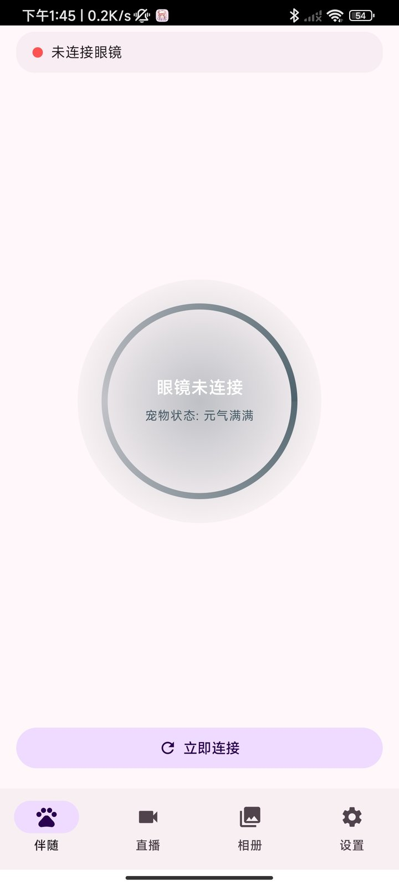
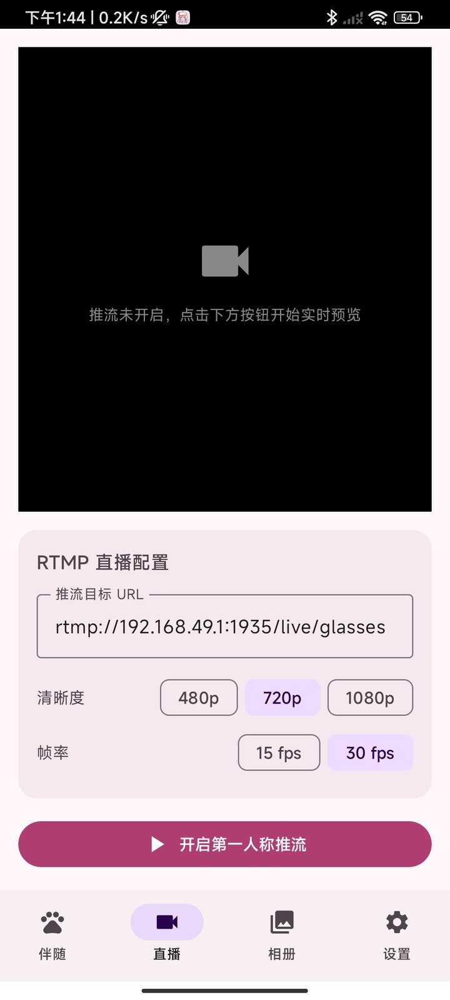
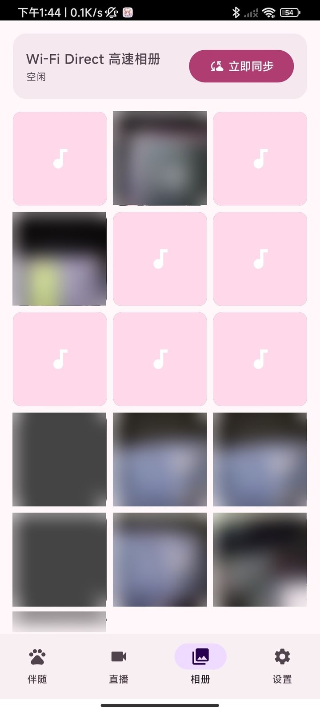
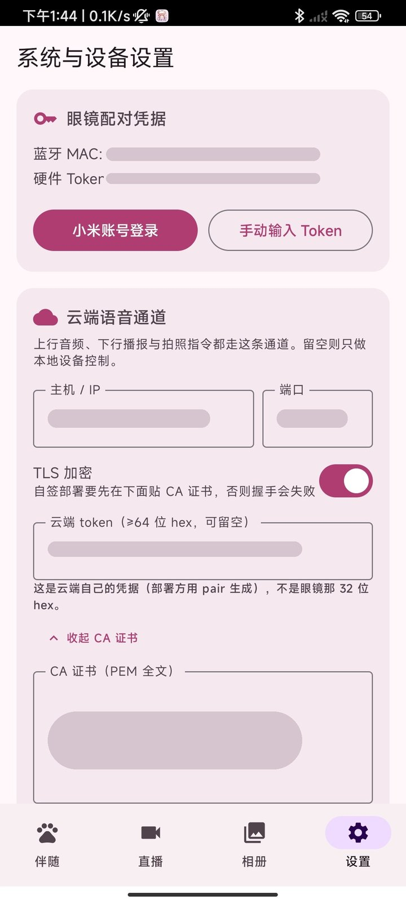
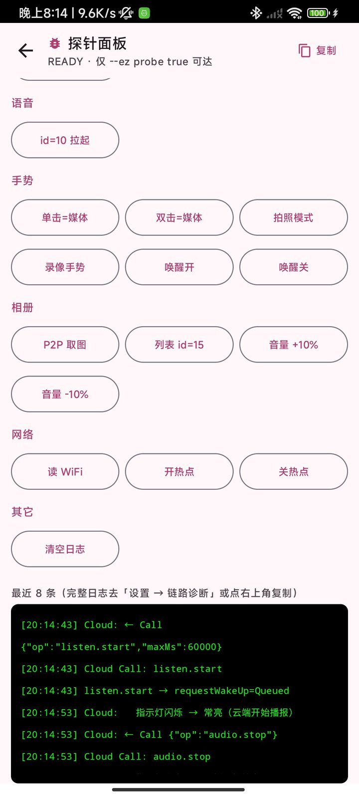

<p align="center">
  
</p>

# xiaomi-ai-glasses2grok-and-so-on

**Third-party Bluetooth protocol analysis, Android SDK and cloud voice backend for the Xiaomi AI Glasses (M2442G1): talk to any LLM.**

[English](README.en.md)<br>
[演示视频](https://www.bilibili.com/video/BV1jn456gEeQ/)

[](https://github.com/slchy/xiaomi-ai-glasses2grok-and-so-on/actions/workflows/ci.yml)

针对小米 AI 智能眼镜（型号 M2442G1）的第三方蓝牙 SPP 通信协议解析、Android SDK 与云端语音后端，可接入任意大模型，做成自定义语音助手。

> **双仓**：本仓是设备侧（协议、SDK、App）；云端语音栈已拆到
> [`dsh-pet-wearable`](https://github.com/slchy/dsh-pet-wearable)。
> 两边零代码依赖，只通过线协议通信。

---

## App 截图

> 🚧 **测试中，即将发布**

示例应用 `sdk/sample/`（包名 `st.moe.mimoe`）的实机截图。敏感字段（蓝牙 MAC、Token、服务器地址、证书）和相册里的私人照片已打码。

<table>
  <tr>
    <td align="center" width="20%"></td>
    <td align="center" width="20%"></td>
    <td align="center" width="20%"></td>
    <td align="center" width="20%"></td>
    <td align="center" width="20%"></td>
  </tr>
  <tr>
    <td align="center"><b>伴随</b><br><sub>连接状态与一键连接</sub></td>
    <td align="center"><b>直播</b><br><sub>第一人称 RTMP 推流，可调清晰度与帧率</sub></td>
    <td align="center"><b>相册</b><br><sub>Wi-Fi Direct 高速同步照片、录像与录音</sub></td>
    <td align="center"><b>设置</b><br><sub>配对凭据与云端语音通道（TLS）</sub></td>
    <td align="center"><b>探针</b><br><sub>协议探针面板：语音 / 手势 / 相册 / 网络命令调试</sub></td>
  </tr>
</table>

---

## 技术文档与规范

- **协议底层规范**：见 [docs/a5a5.md](docs/a5a5.md)（L1 帧格式、滑动窗口、魔数重同步与 SAR 状态机）。
- **协议形式化规范与证明**：见 [docs/FORMAL.md](docs/FORMAL.md)（状态机不变量、GBN 窗口可靠性与反例探索）。
- **协议能力矩阵**：见 [docs/CAPABILITY-MATRIX.md](docs/CAPABILITY-MATRIX.md)（涵盖 58 项硬件与协议能力、实测证据等级与 SDK 封装覆盖）。
- **SDK 架构与实现**：见 [docs/SDK-ARCHITECTURE.md](docs/SDK-ARCHITECTURE.md)（7 模块解耦设计、无锁并发线程模型、车道背压与状态机）。
- **帧解析参考实现（Python）**：位于 `python/a5a5.py`。
- **Android SDK 完整工程**：位于 `sdk/`。
- **自建云端语音后端**：已拆成独立仓库 [`dsh-pet-wearable`](https://github.com/slchy/dsh-pet-wearable)（mSBC 解码 → 判停 → ASR → Agent → TTS）。
- **云端架构**：见新仓的 `docs/CLOUD-ARCHITECTURE.md`（分层、并发模型、状态机、错误模型与扩展点）。

---

## Android SDK

SDK 采用严格的分层单向依赖架构，划分为 7 个模块：

| 模块 | 类型 | 坐标 / 产物 | 职责说明 |
|---|---|---|---|
| `:core-proto` | JVM | 内部实现 | Varint / Hex / CRC16-ARC / MiniJson 基础工具 |
| `:core-api` | JVM | 内部 API | 公开契约层：状态定义、事件模型、查询 DTO 与常量 |
| `:core` | JVM | 内部实现 | 核心协议引擎：L1 解包、L2 多路复用、SAR 状态机、握手认证 |
| `:transport` | Android | 内部实现 | 蓝牙 SPP Socket I/O、后台泵线程与系统广播监听 |
| `:facade` | Android | `io.github.slchy.glasses2grok:sdk` | **主对外门面 AAR**：导出 `GlassesSession` 与高层 API |
| `:ktx` | Android | `io.github.slchy.glasses2grok:sdk-ktx` | **可选协程扩展 AAR**：提供 `Flow<GlassesEvent>` 与挂起扩展 |
| `:sample` | Android | 演示应用（`st.moe.mimoe`） | 伴随 / 直播 / 相册 / 设置四页 App 与协议探针面板（见上方截图） |

### 快速接入 (Gradle)

目前**没有发布到 Maven Central**，先用本地仓库：

```bash
cd sdk
./gradlew publishToMavenLocal        # Windows: gradlew.bat publishToMavenLocal
```

然后让消费工程能解析 `mavenLocal()`（如果你的构建限制了仓库，需要显式加进
`pluginManagement` / `dependencyResolutionManagement`）：

```kotlin
// build.gradle.kts
repositories {
    mavenLocal()
    mavenCentral()
    google()
}
dependencies {
    implementation("io.github.slchy.glasses2grok:sdk:0.2.3")
    implementation("io.github.slchy.glasses2grok:sdk-ktx:0.2.3") // 可选，提供 Kotlin 协程 / Flow 支持
}
```

### 快速上手 (Kotlin)

```kotlin
import io.github.slchy.glasses2grok.core.query.QueryResult
import io.github.slchy.glasses2grok.core.session.GlassesEvent
import io.github.slchy.glasses2grok.sdk.GlassesSession

// 1. 获取已配对的蓝牙设备与 16 字节鉴权 Token
val device: BluetoothDevice = bluetoothAdapter.getRemoteDevice("...")
val token16: ByteArray = ... // 16 字节硬件 Token

// 2. 异步开启会话（非阻塞，可在任意线程调用）
val session = GlassesSession.open(context, device, token16)

// 3. 注册事件监听器
session.addListener { event ->
    when (event) {
        is GlassesEvent.StateChanged -> println("会话状态: ${event.state}")
        is GlassesEvent.WearChanged  -> println("佩戴状态: ${event.status}")
        is GlassesEvent.BatteryChanged -> println("电量变化: ${event.status.batteryPercent}%")
        is GlassesEvent.Image -> {
            println("收到拍摄预览图: ${event.jpeg.size} 字节")
        }
        is GlassesEvent.Audio -> {
            // 实时上行音频流（mSBC 裸流）
        }
        is GlassesEvent.Error -> {
            System.err.println("错误 [${event.code}]: ${event.message}")
        }
        else -> Unit
    }
}

// 4. 非阻塞族：只入队、立即返回 Queued，主线程可调（结果以事件到达）
session.capturePhoto()        // 触发拍照，图片走 GlassesEvent.Image
session.syncTime()            // 同步设备时间
session.requestWearStatus()   // 请设备报一次佩戴状态 → GlassesEvent.WearChanged

// 5. 阻塞族：要等设备回包（默认 3 s，最长 8 s），**必须放后台线程**
//    主线程调用会直接抛 IllegalStateException（SessionOptions.threadGuards 默认开）
lifecycleScope.launch(Dispatchers.IO) {
    when (val r = session.deviceInfo()) {
        is QueryResult.Ok     -> println("设备信息: ${r.value}")
        is QueryResult.Failed -> println("查询失败: ${r.reason}")
    }
}

// 6. 使用 Kotlin Flow 消费（需引入 sdk-ktx）
// lifecycleScope.launch {
//     session.events().collect { event -> ... }
//     session.audio().collect { chunk -> ... }
// }

// 7. 优雅关闭会话
session.close()
```

### 构建与测试

**环境要求**：JDK 17（AGP 8.5 的下限）、Android SDK（`compileSdk 34`，`minSdk 24`）。
Android 模块需要能找到 SDK：设 `ANDROID_HOME`，或在 `sdk/local.properties` 写 `sdk.dir=<路径>`
（该文件已在 `.gitignore` 里，不会入库）。

SDK 包含覆盖全协议栈的纯 JVM 单元测试与黄金向量回归：

```bash
cd sdk
./gradlew test          # 全部模块的单测（经纯 JVM 仿真，不需要真机）
./gradlew build         # 额外做 lint 与各 AAR 打包
```

---

## 云端语音后端（已迁出）

`sdk/` 管「手机 ↔ 眼镜」，云端管「手机 ↔ 大模型」。手机把眼镜的上行 mSBC **原样**转发过来，
云端解码 → 判停 → ASR → Agent → TTS，再把 PCM 流式推回手机播放：

```text
眼镜 ──SPP──▶ 手机（sdk/sample）──TLS/TCP──▶ 云端 ──▶ ASR ──▶ Agent ──▶ TTS
                                              └─ 原始档案 / 离线补播 / 调试控制口
```

**云端已拆成独立仓库 [`dsh-pet-wearable`](https://github.com/slchy/dsh-pet-wearable)**，
本仓只留设备侧（协议、SDK、App）。两边零代码依赖，只通过这条线协议通信。

为什么分：两条线变更节奏完全不同 —— 协议线摸到新命令才动，语音线调参数是日常。

迁过去的东西：

| 环节 | 默认实现 | 换成别的 |
|---|---|---|
| 上行解码 | `ffmpeg`（mSBC → PCM16 16 kHz） | — |
| 判停 | 能量门；可选 SmartTurn / silero-vad | `SMART_TURN=0` 关掉 |
| ASR | 阿里云实时语音识别 | `--stt canned` 或实现 `providers.ts` 的接口 |
| Agent | 命令式 agent（默认用 `dsh` 的 SDK 会话） | `--agent echo` / `--agent none` |
| TTS | MiMo（情绪标签可切语调） | `--tts silent` 或实现 `providers.ts` 的接口 |

不接真机、不填凭据也能跑通整条链路（假手机 + `--stt canned --tts silent --agent echo`），
纯逻辑单测不需要网络 —— 都在新仓里。分层、并发模型、状态机与错误模型见新仓的
`docs/CLOUD-ARCHITECTURE.md`。

许可：云端部分采用 [MIT License](LICENSES/MIT.txt)。

---

## Python 快速验证

针对 L1 帧解包与校验，仓库提供了无第三方依赖的 Python 参考实现：

```bash
python tests/test_frame.py
```

```python
from a5a5 import build, parse

frame = build(b"hi", ftype=3, seq=0)
frames, bad_crc, resync, dropped = parse(frame)
```

> 调用时请将 `python/` 加入 `PYTHONPATH`。

---

## 许可证 (Licensing)

本项目采用多许可证分层管理，详见 [LICENSE.md](LICENSE.md)：

- **协议规范与帧参考实现 (`docs/`, `python/`)**：[CC0 1.0 Universal](LICENSES/CC0-1.0.txt)（公有领域奉献）
- **Android SDK 核心驱动 (`sdk/core`, `transport`, `facade`, `ktx`)**：[PolyForm Noncommercial License 1.0.0](LICENSES/PolyForm-Noncommercial-1.0.0.txt)（仅限非商业研究）
- **示例应用代码 (`sdk/sample/`)**：[MIT License](LICENSES/MIT.txt)

---

## 免责声明 (Disclaimer)

1. 本项目为独立研究者的第三方开源成果，**与小米科技（Xiaomi）或蜂巢科技（Superhexa）无任何附属、赞助或认可关系**。
2. 所有提及的产品名称与商标版权均归原厂商所有，在此仅用于客观技术兼容性说明。
3. 本项目**不内置分发、不经由第三方服务器中转代取、不在云端保存**任何硬件访问凭据（Token）。运行所需的通信凭据须由用户基于自身合法资产提供（支持纯离线手动配置，或在用户端侧本地直接向设备所属品牌方的鉴权接口发起只读查询）。使用本项目的研究者须自行确保对所连接的硬件拥有合法的所有权与操作权限。