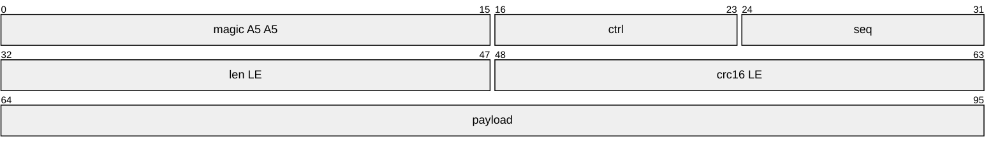
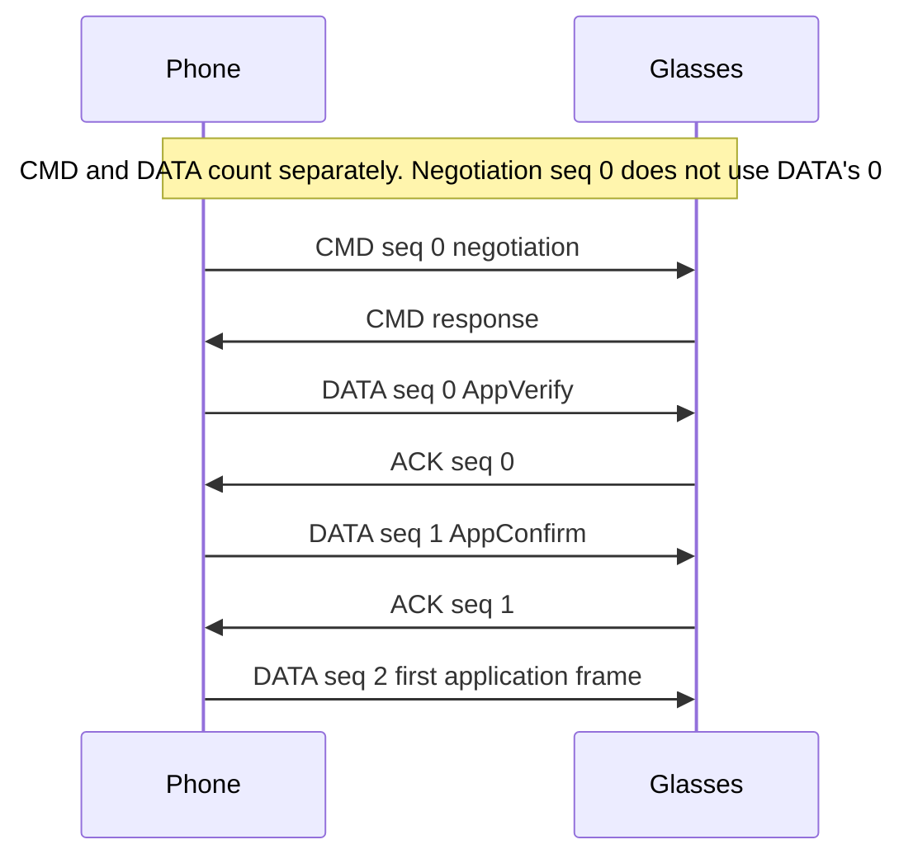
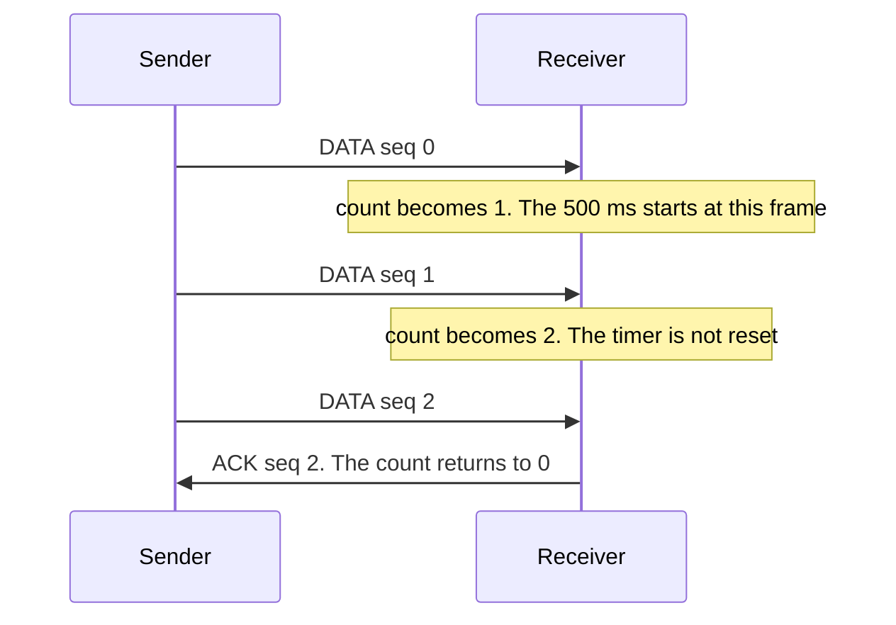
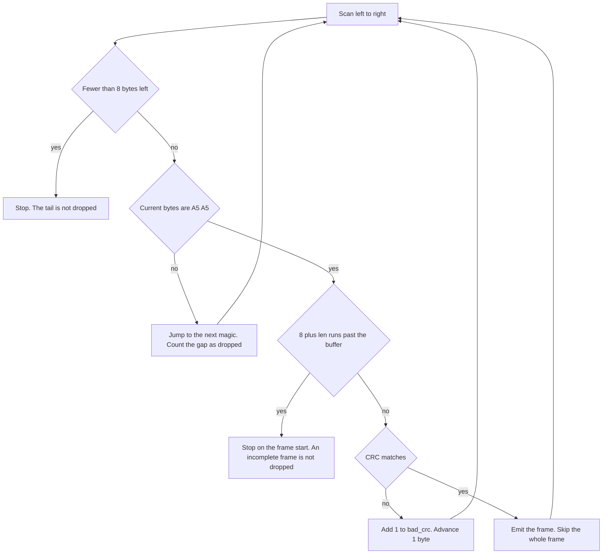
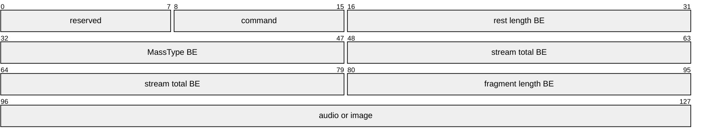
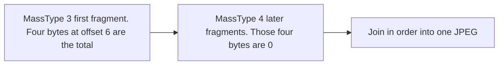
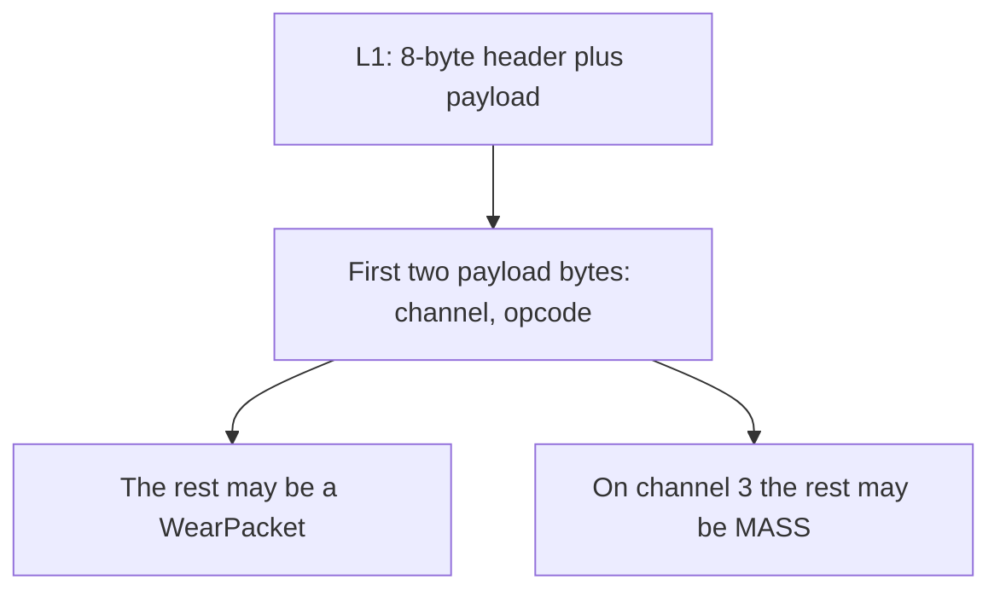

# A5A5 frame

[中文](a5a5.md)

L1 frame on SPP. There is no separate trailer: the length field delimits the frame, and the CRC checks the payload.
`python/a5a5.py` provides a standalone Python reference for L1 packet framing and parsing; the full sliding window (SAR), dual sequence spaces, and retransmission state machines are implemented in the Android SDK (`sdk/core`).
Tested properties are in [FORMAL.en.md](FORMAL.en.md).

## Layout

Multi-byte fields are little-endian, starting at offset 0.

| Offset | Length | Field | Meaning |
|---|---|---|---|
| 0 | 2 | magic | fixed `A5 A5` |
| 2 | 1 | ctrl | low 4 bits = type, bit4 = frx, bit5–7 reserved |
| 3 | 1 | seq | sequence number, wraps through 0–255 |
| 4 | 2 | len | payload length, 0 to 65535 |
| 6 | 2 | crc16 | `CRC-16/ARC(payload)` |
| 8 | len | payload | payload |

Total length = `8 + len`. The wire byte is `ctrl = (frx << 4) | type`. `pack_ctrl` / `unpack_ctrl` pack and unpack that nibble. The `type` field returned by `build` / `parse` is the whole ctrl byte.



The low 4 bits of `ctrl` are the type. Bit 4 is frx. `len` sets the payload length. The drawing shows only the start of the payload.

### type

| Value | Name |
|---:|---|
| 0 | NAK |
| 1 | ACK |
| 2 | CMD |
| 3 | DATA |

### frx

| Frame | Meaning of frx=1 |
|---|---|
| DATA | force the peer's expected sequence number to `seq + 1`, without checking the previous expectation |
| ACK / NAK | force flag |

## CRC-16/ARC

- Polynomial `0x8005`, computed with the reflected polynomial `0xA001`
- init = 0, xorout = 0
- Covers the payload only, not the 8-byte header
- `crc16_arc(b"123456789") == 0xBB3D`
- Any single-bit flip in the payload changes the CRC
- The CRC of an empty payload is 0. An empty ACK is therefore `A5 A5 01 <seq> 00 00 00 00`

On a CRC failure the peer tries to find the next magic byte by byte. As this behavior varies across firmware implementations, a bad frame cannot be assumed to be discarded. `parse` in this repository does not place a frame with a bad CRC into `frames`. Frames you send must carry a correct CRC.

## Sequence numbers

CMD and DATA each have their own counter. The caller chooses the CMD sequence number. The DATA sequence number increments from 0 and wraps through 0–255.

The first three DATA sequence numbers in a session are fixed: AppVerify is 0, AppConfirm is 1, and the first application DATA after that is 2. CMD negotiation uses seq 0 on its own counter and does not consume DATA's 0. Only the sequence numbers are recorded here, not the payloads of those three steps.

ACK / NAK do not consume either counter.

- For an in-order DATA frame, the ACK sequence number equals that frame's sequence number.
- A NAK carries the sequence number the peer expected, not the one just received.
- An 8-bit difference `uint8(received seq - expected seq) >= 128` is an old retransmission: drop it and do not send a NAK.
- Otherwise send a NAK and leave the expected sequence number unchanged.
- A DATA frame with `frx=1` skips that comparison and sets the expected sequence number to `seq + 1`.

An empty ACK and an empty NAK are both 8 bytes: `len = 0`, `crc = 0`. A NAK has type 0, and `frx` is the force flag.



The drawing marks sequence numbers only. The payloads of those steps are not on this page.

## Reliable delivery

These are protocol rules. The `python/a5a5.py` parser only handles single-frame encoding/decoding and does not run windows or retransmission; complete windowing and retransmission scheduling reside in `sdk/core` (`SarEngine`).

- Before link-parameter exchange completes, do not send DATA, and do not ACK DATA that arrives. A disconnect or reset clears that flag. Sequence numbers start again at 0; the old values are not reused.
- Only DATA with type=3 requires an ACK. CMD does not. L2 channel 7 requires no ACK in either direction.
- Channel 1 and channel 8 are acknowledged immediately. Other channels may accumulate. The threshold is the remote window times 2, divided by 3, truncated. The default remote window is 4, so the threshold is 2. This device returns window 3, and the threshold is still 2.
- The cumulative wait is at most 500 ms, measured from the first frame of the round. Later frames do not reset the timer. The threshold check uses the count from before the current frame: decide whether to ACK immediately, then add one. After a cumulative ACK, the count returns to zero.
- With window 3 and threshold 2: frame 1 starts the 500 ms timer and the count becomes 1; frame 2 makes the count 2 and does not reset the timer; frame 3 meets the threshold, sends an immediate ACK, and clears the count. If the stream pauses, the timer fires and ACKs the newest received sequence number.


- The send-timeout constant in this implementation is 10 seconds. On that timeout, or on NAK, retransmit every unacknowledged frame from that frame onward. The timeout matters when no later frame arrives to expose the gap. A device log once showed 6 seconds, and that log is gone, so both 10 seconds and 6 seconds stay on record. Neither one is treated as a finished measurement of the device.
- In the reference implementation, the local send window is hardcoded to 32 and ignores the peer window (sending pauses when `txNextSeqNum - txBase > 32`). This device's receive window is only 3. In `sdk/core`, the transmission ceiling is clamped to the negotiated `remoteTXWindow` (measured as 3), ensuring in-flight frames never exceed the window and preventing device NAKs.
- MPS is a per-frame cap, including the 2-byte L2 header. If `len(body) + 2 > MPS`, the send fails and the frame is not split. The default is 64512 and is used before parameter exchange; this device returns **32768**. An empty L2 payload is not sent. A lower layer may write one frame in several MTU-sized pieces. That is not an MPS split.
- Send priority is an integer from 0 to 10. 0 is the default and 10 is the highest. A value outside that range fails the send. This repository does not implement priority.

## Parsing

`parse(data)` returns `(frames, bad_crc, resync, dropped)` and scans left to right.

1. Stop when fewer than 8 bytes remain. That tail is not counted in `dropped`. For `A5 A5 00`, `dropped` is 0.
2. If the current position is not `A5 A5`, find the next magic, count the bytes in between as `dropped`, and add 1 to `resync`. If none is found, count the rest as `dropped`.
3. Read `len`. If `8 + len` runs past the buffer, stop at the start of that frame. The bytes are an incomplete frame and are not counted in `dropped`. A streaming reader must keep them and wait. Dropping them swallows a large frame that arrived in pieces, while small frames that arrive whole are unaffected.
4. If the CRC does not match, add 1 to `bad_crc`, advance 1 byte, and continue.
5. If the CRC matches, emit one frame and skip the whole frame.

Each frame is a dict: `off`, `type` (the ctrl byte), `seq`, `len`, `crc`, `payload`, and `total` (`8 + len`).



## WearPacket container

The outer message is protobuf. Field 1 (tag `08`) is type, and field 2 (tag `10`) is id.
The field number that carries the application body is `type + 2`, with wire type 2 (length-delimited). The tag must be computed from type:

```
tag = varint(((type + 2) << 3) | 2)
empty body = tag ‖ 00
```

| type | Field | tag |
|---:|---:|---|
| 1 | 3 | `1A` |
| 2 | 4 | `22` |
| 13 | 15 | `7A` |
| 14 | 16 | `82 01` |
| 18 | 20 | `A2 01` |
| 20 | 22 | `B2 01` |
| 23 | 25 | `CA 01` |

`22` belongs only to type 2. Writing `22` for any other type uses the wrong container field.

`WearPacket.id` is a per-channel command number. It has no formula relating it to the protobuf field number. The container field number is still `type + 2`. Those are different numbers.

## MASS packets on channel 3

Uplink speech and vision images both use L2 channel 3 and opcode 2. Opcode 2 bytes are ciphertext (AES-CTR with `key == iv`, counter reset to 0 per frame). The cipher algorithms are implemented in `sdk/core` (`Crypto.kt`), while `python/a5a5.py` serves as a plaintext framing reference.
Channel 2 carries event logs, not images. Vision upload does not use Wi-Fi or P2P.

Multi-byte integers in the plaintext are big-endian. Packet length does not separate audio from images: an image fragment can also be 582 bytes (12+570). Read MassType.

| Offset | Length | Field |
|---|---|---|
| 0 | 1 | reserved; observed packets are always `00`; meaning unknown |
| 1 | 1 | command |
| 2 | 2 | length of the rest, equal to the packet length minus 4 |
| 4 | 2 | MassType; DATA only |
| 6 | 4 | total data length of this stream. Set on the first fragment, 0 after that. Not a session id |
| 10 | 2 | this fragment's data length, equal to the packet length minus 12 |
| 12 | rest | audio or image bytes |



Short packets:

| Length | Shape | Meaning |
|---:|---|---|
| 2 | `00 03` | END (the official receiver ignores this packet; streams terminate based on declared total length) |
| 5 | `00 01 00 01` plus 1 byte | START. The last byte has been seen as `c8`; its meaning is unknown |
| 12+N | `00 02 …` | DATA |

Commands: 1 START, 2 DATA, 3 END, 4 QUIT. Values 65-69 are ordinary recording, recording, live translation, speech notes, and voiceprint.

MassType: 1 first dialog-audio fragment, 2 following dialog audio, 3 first vision image, 4 following vision image, 5 OCR, 6 first wake-word audio, 7 following wake-word audio, 8 conversation thumbnail, 9 conversation original, 10 telemetry, 11 following HD image. Image bytes are raw JPEG and are not encoded again. Vision images are type 3 followed by type 4, in order. The total length is `[6:10]` of the first fragment.



One checked dialog-audio DATA packet is 582 bytes, MassType 2, `[6:10]` zero, and the following 570 bytes are ten 57-byte mSBC frames. mSBC is the standard Bluetooth HFP 1.6 wideband-speech frame. One frame is sync word `AD`, two reserved bytes `00 00`, one checksum byte, four scale-factor bytes, and 49 bytes of quantized samples. 16 kHz, mono, 8 subbands, 15 blocks, bitpool 26, 7.5 ms, about 60.8 kbps. Ten frames are 75 ms. The first wake-audio payload can hold many frames in one packet. One checked payload was 10317 bytes and 181 frames. The packet length is not fixed. Use `[10:12]`.

Channel 3 carries uplink only. mSBC sent back on this channel is acknowledged and produces no sound. Spoken playback goes over A2DP.

The MASS header sent from the phone to the glasses is different: 22 bytes, little-endian. `[0]` is 0, `[1]` is `(type << 4) | subType`, `[2:18]` is a 16-byte digest of the payload, and `[18:22]` is the payload length. Uplink is 12 bytes big-endian. This 22-byte little-endian header is a different layout. Do not mix them.

The phone starts a vision capture with WearPacket type 14, id 4. Id 9 is not that command. The transaction id and the request id are the pair that arrived with the wake, which is WearPacket type 14, id 10. A transaction id invented on the phone gets no image back. The payload also carries a JSON object with the keys `type`, `quality`, `resizeRatio`, `isSkipOcr`, and `resourceId`, and a cmd integer. The image then returns on channel 3 as MassType 3 followed by MassType 4.

## L2 header

The first two bytes of the payload are the L2 header: `channel | opcode | rest`. `l2_pack` / `l2_unpack` only join and split those two bytes.



| channel | Name |
|---:|---|
| 1 | PB |
| 2 | MASS |
| 3 | MASS_VOICE |
| 4 | FILE_SENSOR |
| 5 | FILE_FITNESS |
| 6 | OTA |
| 7 | NETWORK |
| 8 | LYRA |
| 9 | RESEARCH |

| opcode | Name |
|---:|---|
| 1 | WRITE, plaintext |
| 2 | WRITE_ENC, payload is ciphertext |
| 3 | READ |

Encryption is selected only by whether the opcode is 2, independent of channel. The cipher algorithms (AES-CTR / AES-CCM) are implemented in `sdk/core`.
