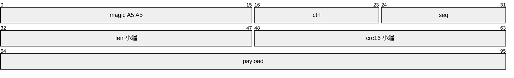
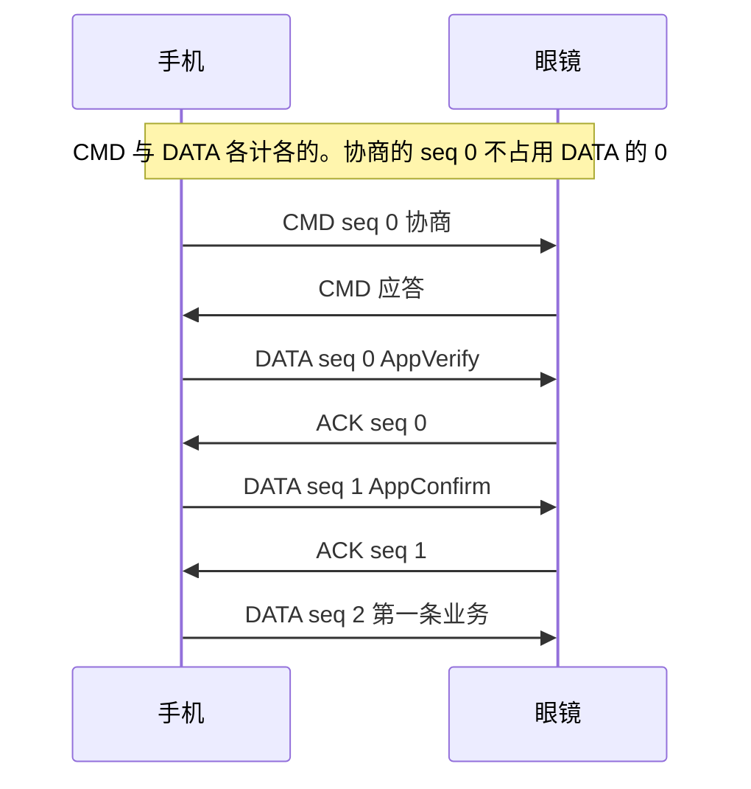
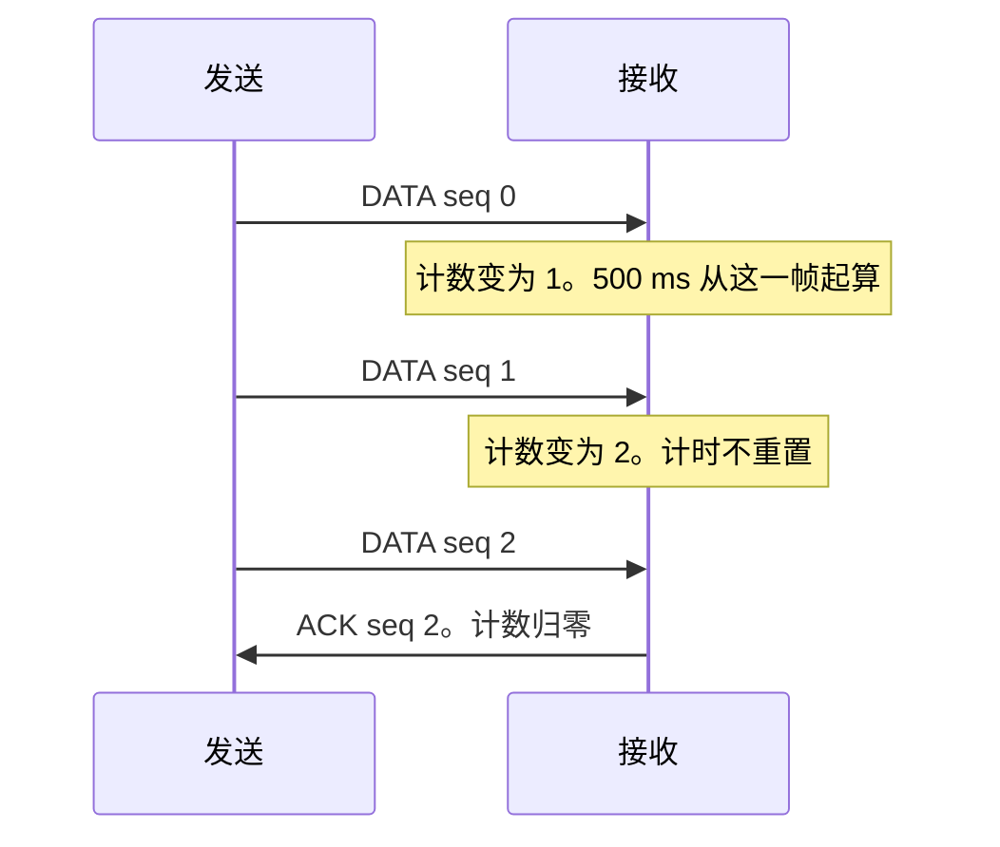
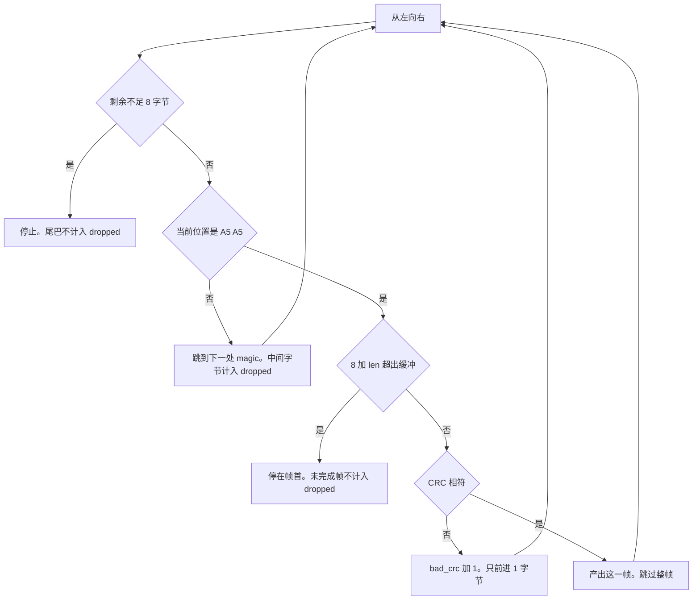
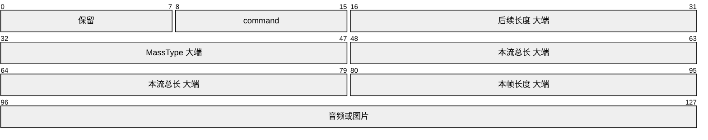
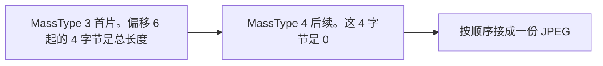
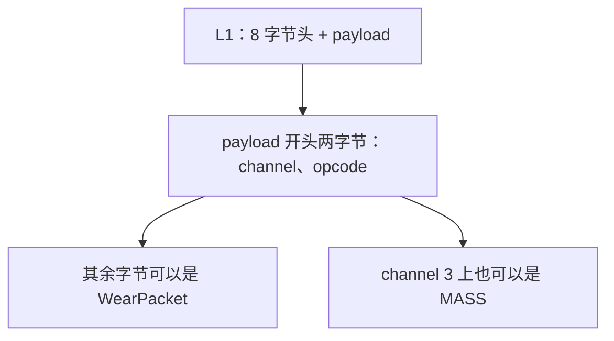

# A5A5 帧

[English](a5a5.en.md)

SPP 上的 L1 帧。没有单独的帧尾：用长度字段定界，用 CRC 检查 payload。
本仓库实现组帧和解析。滑动窗口、重传不在 `python/a5a5.py` 里。
已测性质见 [FORMAL.md](FORMAL.md)。

## 布局

从偏移 0 开始，多字节字段为小端。

| 偏移 | 长度 | 字段 | 含义 |
|---|---|---|---|
| 0 | 2 | magic | 固定 `A5 A5` |
| 2 | 1 | ctrl | 低 4 位 = type，bit4 = frx，bit5–7 保留 |
| 3 | 1 | seq | 序号，0–255 回绕 |
| 4 | 2 | len | payload 字节数，0 到 65535 |
| 6 | 2 | crc16 | `CRC-16/ARC(payload)` |
| 8 | len | payload | 负载 |

总长 = `8 + len`。线字节 `ctrl = (frx << 4) | type`。`pack_ctrl` / `unpack_ctrl` 做这半字节的拼拆。`build` / `parse` 的 `type` 字段是完整的 ctrl 字节。



`ctrl` 的低 4 位是 type，bit4 是 frx。payload 的长度由 `len` 决定，图里只画出开头的一段。

### type

| 值 | 名称 |
|---:|---|
| 0 | NAK |
| 1 | ACK |
| 2 | CMD |
| 3 | DATA |

### frx

| 帧 | frx=1 的含义 |
|---|---|
| DATA | 强制把对端期望序号设为 `seq + 1`，不再核对本帧是否等于原期望值 |
| ACK / NAK | force 标志 |

## CRC-16/ARC

- 多项式 `0x8005`，按反射多项式 `0xA001` 计算
- init = 0，xorout = 0
- 只覆盖 payload，不覆盖 8 字节头
- `crc16_arc(b"123456789") == 0xBB3D`
- payload 中任意一比特翻转，CRC 都会改变
- 空 payload 的 CRC 是 0。因此空 ACK 为 `A5 A5 01 <seq> 00 00 00 00`

对端在 CRC 失败时会尝试按字节重新寻找 magic。该路径没有完整反编译，不能认定坏帧一定被丢弃。本仓库的 `parse` 不把 CRC 错误的帧放进 `frames`。发出的帧必须带正确的 CRC。

## 序号

CMD 与 DATA 各有一个计数器。CMD 的 seq 由调用方指定。DATA 的 seq 从 0 递增，回绕范围是 0–255。

会话里 DATA 计数器的前三个取值是固定的：AppVerify 为 0，AppConfirm 为 1，其后第一条业务 DATA 为 2。CMD 协商单独用 seq 0，不占用 DATA 的 0。这里只记录序号，不记录这三步的载荷。

ACK / NAK 不占用这两套计数。

- 按序到达的 DATA：ACK 的 seq 等于该帧的 seq。
- NAK 的 seq 等于对端期望的 seq，不是刚收到的那一帧。
- 8 位差值 `uint8(收到的 seq - 期望 seq) >= 128` 视为过期重传，静默丢掉，不发 NAK。
- 否则发 NAK，期望序号不变。
- `frx=1` 的 DATA 不做上述比较，直接把期望序号设为 `seq + 1`。

空 ACK 与空 NAK 都是 8 字节：`len = 0`，`crc = 0`。NAK 的 type 为 0，`frx` 表示 force。



图里只标序号。这三步的载荷不在本页。

## 可靠传输

这些是协议规则。本仓库的解析器不执行窗口、计时和重传。

- 链路参数交换完成前，不发送 DATA，也不对收到的 DATA 回 ACK。断线或复位后这个标志清掉，序号从 0 重新计，不沿用旧值。
- 只有 type=3 的 DATA 需要 ACK。CMD 不需要。L2 channel 7 双向都不需要 ACK。
- channel 1 与 channel 8 立即 ACK。其余通道可以累积。阈值是远端窗口乘 2 再除以 3，取整。默认远端窗口 4，阈值 2。这台设备返回窗口 3，阈值仍是 2。
- 累积等待上限 500 ms，从这一轮第一帧起算。后面的帧不重置计时。判定阈值时用的是还没加上本帧的计数：先判断要不要立即 ACK，再把计数加一。发出累积 ACK 后计数归零。
- 窗口 3、阈值 2 时：第 1 帧启动 500 ms 计时，计数变为 1；第 2 帧计数变为 2，计时不重置；第 3 帧达到阈值，立即 ACK 并清零。若中途停住，500 ms 到时用最新的已收序号发 ACK。


- 发送超时在实现里的常量是 10 秒，或收到 NAK：从该帧起，尚未确认的帧全部重传。超时主要影响后面没有新帧来暴露缺口的那一帧。设备侧曾经有一条 6 秒的日志，原始日志已经不在，所以 10 秒和 6 秒都先留着，不把其中一边写成已经测完。
- 本地发送窗口写死 32，不看远端窗口。`txNextSeqNum - txBase > 32` 时停发。这台设备的接收窗口只有 3。在途帧超过 3 时会不会 NAK，尚未验证。
- MPS 是单帧上限，含 2 字节 L2 头。`len(body) + 2 > MPS` 直接失败，不拆帧。默认 64512，参数交换前用默认值；这台设备返回 **32768**。L2 载荷为空则不发送。同一帧在更底层按 MTU 分次写出，那不是 MPS 拆包。
- 发送优先级是 0 到 10 的整数，0 为默认，10 为最高。超出这个范围则发送失败。本仓库不实现优先级。

## 解析

`parse(data)` 返回 `(frames, bad_crc, resync, dropped)`，从左向右扫描。

1. 剩余不足 8 字节时停止。这截尾巴不计入 `dropped`。`A5 A5 00` 的 `dropped` 是 0。
2. 当前位置不是 `A5 A5`：找到下一处 magic，中间字节计入 `dropped`，`resync` 加 1。找不到则剩余全部计入 `dropped`。
3. 读出 `len`。若 `8 + len` 超出缓冲区，停在帧首。这截是未完成帧，不计入 `dropped`。流式读取必须自己保留它，等后续字节。把它丢掉会吞掉被拆开的大帧，而整包到达的小帧不受影响。
4. CRC 不符：`bad_crc` 加 1，前进 1 字节，继续扫描。
5. CRC 相符：产出一帧，跳过这整帧。

每帧是一个字典：`off`、`type`（ctrl 字节）、`seq`、`len`、`crc`、`payload`、`total`（`8 + len`）。



## WearPacket 容器

外层是 protobuf。field 1（tag `08`）是 type，field 2（tag `10`）是 id。
承载业务的字段号是 `type + 2`，wire type 为 2（带长度）。tag 必须按 type 现算：

```
tag = varint(((type + 2) << 3) | 2)
空内容 = tag ‖ 00
```

| type | 字段号 | tag |
|---:|---:|---|
| 1 | 3 | `1A` |
| 2 | 4 | `22` |
| 13 | 15 | `7A` |
| 14 | 16 | `82 01` |
| 18 | 20 | `A2 01` |
| 20 | 22 | `B2 01` |
| 23 | 25 | `CA 01` |

`22` 只属于 type 2。把别的 type 也写成 `22`，容器字段是错的。

`WearPacket.id` 是通道内的命令编号，和 protobuf 字段号没有公式。容器字段号仍然是 `type + 2`，两者不是一回事。

## channel 3 上的 MASS 包

上行语音和识图图片都在 L2 channel 3、opcode 2。opcode 2 的字节是密文，算法不在本仓库。
channel 2 上看到的是事件日志，不是图片。识图不走 Wi-Fi / P2P。

明文多字节整数是大端。不能用包长区分音频和图片：图片分片也可以是 582 字节（12+570）。要看 MassType。

| 偏移 | 长度 | 字段 |
|---|---|---|
| 0 | 1 | 保留，已观察的包里恒为 `00`，语义未知 |
| 1 | 1 | command |
| 2 | 2 | 后续长度，等于整包长度减 4 |
| 4 | 2 | MassType，仅 DATA |
| 6 | 4 | 这条流的总数据长度。首片携带，后续片为 0。不是会话号 |
| 10 | 2 | 本帧数据长度，等于整包长度减 12 |
| 12 | 余下 | 音频或图片字节 |



短包：

| 长度 | 形状 | 含义 |
|---:|---|---|
| 2 | `00 03` | END |
| 5 | `00 01 00 01` 再加 1 字节 | START。最后 1 字节已见到 `c8`，含义未知 |
| 12+N | `00 02 …` | DATA |

command：1 START，2 DATA，3 END，4 QUIT。另有 65–69，分别是普通录音、录音、实时翻译、语音备忘、声纹。

MassType：1 对话音频首片，2 对话音频后续，3 识图首片，4 识图后续，5 OCR，6 唤醒音频首片，7 唤醒音频后续，8 对话缩略图，9 对话原图，10 埋点，11 高清图后续。图片字节是原始 JPEG，不再编码。识图要把 type 3 的首片和 type 4 的后续片按顺序接起来；总长度在首片的 `[6:10]`。



对话音频的一种已核对 DATA 包是 582 字节，MassType 为 2，`[6:10]` 为 0，后面 570 字节是 10 个 57 字节 mSBC 帧。mSBC 是 Bluetooth HFP 1.6 宽带语音的标准帧。单帧：同步字 `AD`，2 字节保留 `00 00`，1 字节校验，4 字节 scale factor，49 字节量化样本。16 kHz，单声道，8 子带，15 块，bitpool 26，7.5 ms，约 60.8 kbps。10 帧是 75 ms。唤醒音频的首包可以是一整段很多帧，已见到 10317 字节、181 帧的一包。包长不固定，以 `[10:12]` 为准。

channel 3 只承担上行。把 mSBC 从这条通道送回眼镜时，帧会被确认，播放没有声音。说话的下行播放走 A2DP。

手机发往眼镜的 MASS 头是另一套：22 字节，小端。`[0]` 为 0，`[1]` 是 `(type << 4) | subType`，`[2:18]` 是载荷的 16 字节摘要，`[18:22]` 是载荷长度。上行 12 字节大端，这套 22 字节小端，不能混用。

识图由手机发起。WearPacket type 为 14、id 为 4。id 9 不是这条命令。transaction id 和 request id 用同一次唤醒带来的那一对。唤醒事件是 WearPacket type 14、id 10。手机另造一个 transaction id 时，眼镜不回图。载荷里还有一份 JSON（键为 `type`、`quality`、`resizeRatio`、`isSkipOcr`、`resourceId`）和一个 cmd 整数。图片随后以 MassType 3、4 回到 channel 3。

## L2 头

payload 的前两字节是 L2 头：`channel | opcode | 剩余字节`。`l2_pack` / `l2_unpack` 只拼接和拆开这两个字节。



| channel | 名称 |
|---:|---|
| 1 | PB |
| 2 | MASS |
| 3 | MASS_VOICE |
| 4 | FILE_SENSOR |
| 5 | FILE_FITNESS |
| 6 | OTA |
| 7 | NETWORK |
| 8 | LYRA |
| 9 | RESEARCH |

| opcode | 名称 |
|---:|---|
| 1 | WRITE，明文 |
| 2 | WRITE_ENC，payload 为密文 |
| 3 | READ |

是否加密只看 opcode 是不是 2，与 channel 无关。密文算法不在本仓库。
